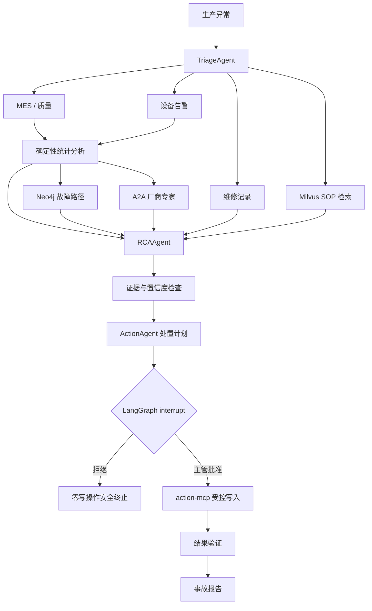

# FactoryPilot

FactoryPilot 是一个面向 MES 场景的“生产异常诊断与闭环处置 Agent”。它会并行查询生产、质量、告警、维修和知识数据，形成带引用的根因假设；高风险写操作在 LangGraph checkpoint 处暂停，只有具备权限的人员审批后，才会通过受控 MCP 工具执行并生成事故报告。

全部业务数据均为确定性合成数据，不包含实习公司数据。

## 项目文档

- [Word 项目说明与面试手册](docs/FactoryPilot项目说明与面试手册.docx)：67 页正式排版版本，整合项目说明、架构图、105 道面试问答和快速复习卡。
- [详细项目说明](docs/PROJECT_GUIDE.md)：业务背景、技术架构、LangGraph 工作流、统计分析、MCP、RAG、安全、部署、评测、演示脚本与迭代边界。
- [面试问题与参考答案](docs/INTERVIEW_QA.md)：项目介绍模板，以及 100+ 个架构、Agent、数据分析、RAG、安全、评测和生产化追问题。

## 已实现能力

- LangGraph 并行证据收集、根因分析、风险计划、`interrupt` 审批、执行、验证和事故报告。
- LLM 前置确定性统计节点：计算最近 20 批次趋势、异常前后均值、工艺参数与缺陷率 Pearson 相关性、告警时间重合及连续三批恢复条件；统计结果作为 RCA 证据而非让模型直接猜测。
- SQLite 本地模式与 MySQL 8 生产化数据模式；所有查询参数化，Agent 没有任意 SQL 执行能力。
- 10 台设备、1000+ 告警、500 个批次、100+ 维修记录、30 份手册/SOP。
- Milvus 向量检索与关键词分数融合重排，结果包含文档、章节、版本和分数；故障时可配置降级到本地检索。
- `mes-mcp`、`knowledge-mcp`、`action-mcp` 三个真实 MCP v2 Streamable HTTP Server。
- MCP Client 超时、有限重试、结构化输出解析；所有工具调用写入审计日志。
- Spring Boot WebFlux 网关、JWT HttpOnly Cookie、RBAC；只有 `SUPERVISOR`/`ADMIN` 可审批。
- 网关向 Agent Service 注入共享密钥，生产模式禁止绕过网关直接访问业务 API。
- SQLite checkpoint 持久化；服务重启后可按同一 `thread_id` 恢复人工审批任务。
- Redis 提供跨进程任务锁、SSE 事件唤醒和 A2A 任务状态缓存；MySQL 仍是业务状态与事件的最终事实来源。
- Celery + Redis Broker 将诊断与审批恢复任务投递到独立 Worker，支持 late ack、Worker 丢失拒绝、有限重试和确定性任务 ID。
- Neo4j 保存“设备型号—部件—故障模式—症状—措施—SOP”故障路径，使用参数化只读 Cypher 为 RCA 增加多跳关系证据。
- 独立设备厂商专家 Agent 通过 A2A v0.3 Agent Card 和 JSON-RPC `message/send` 对外提供能力，内部 LangGraph 节点仍直接编排。
- React + TypeScript 操作台展示执行时间线、20 批趋势、统计证据、相关性、证据链、审批方案与报告。
- pytest、MCP 协议测试、Spring Security 集成测试、前端构建、80 条本地回归集、真实 DeepSeek 配置对比与 LangSmith 在线评测入口。

## 架构与工作流

```text
React :3000
  └─ Spring Gateway :8080  JWT / RBAC / SSE proxy
       └─ FastAPI Agent :8000 ── Redis/Celery ── Agent Worker
            ├─ mes-mcp :8101 ─────────────────────┐
            ├─ knowledge-mcp :8102 ─ Milvus       │─ MySQL
            ├─ action-mcp :8103 ──────────────────┘
            ├─ Neo4j 故障知识图谱
            └─ A2A 厂商专家 Agent :8200
```



## 推荐启动：完整 Docker 环境

要求 Docker Desktop 已启动。首次拉取 MySQL、Milvus、MinIO 等镜像会花一些时间。

```powershell
Copy-Item .env.example .env
docker compose up -d --build
docker compose ps
```

打开 <http://localhost:3000>，使用演示账号登录：

| 用户名 | 密码 | 角色 |
| --- | --- | --- |
| `operator` | `operator123` | 只读和发起诊断 |
| `supervisor` | `supervisor123` | 发起诊断、批准/拒绝 |
| `admin` | `admin123` | 管理员演示角色 |

常用地址：

- React：<http://localhost:3000>
- Gateway：<http://localhost:8080/actuator/health>
- Agent 健康检查：<http://localhost:8001/health>
- Swagger：<http://localhost:8001/docs>（生产模式下业务 API 仍需要网关密钥）
- MCP：`http://localhost:8101/mcp`、`8102/mcp`、`8103/mcp`
- Milvus：`localhost:19531`（避免占用本机已有的 `19530`）
- MySQL：`localhost:3307`（避免占用本机已有的 `3306`）
- Redis：`localhost:6380`（容器内 Broker 使用 `redis:6379`）
- Neo4j Browser：<http://localhost:7475>，Bolt：`localhost:7688`
- A2A Agent Card：<http://localhost:8200/.well-known/agent-card.json>

查看日志或停止服务：

```powershell
docker compose logs -f agent-service mes-gateway knowledge-mcp
docker compose stop
```

`stop` 不会删除 MySQL、Milvus 或 checkpoint 数据。只有明确需要清空演示数据时才使用 `docker compose down -v`。

## 轻量本地开发模式

本地模式使用 SQLite、进程内安全工具和词法检索，不依赖 MySQL/Milvus/MCP Server，但前端仍通过带身份认证的 Java 网关访问。
建议使用 Python 3.11+、Node.js 18+ 和 Java 8+。

终端 1：

```powershell
python -m venv .venv
.\.venv\Scripts\python.exe -m pip install -e ".\agent-service[dev]"
.\.venv\Scripts\python.exe -m uvicorn factorypilot.main:app --app-dir agent-service --reload --port 8000
```

终端 2：

```powershell
cd mes-gateway
mvn spring-boot:run
```

终端 3：

```powershell
cd frontend
npm install
npm run dev
```

打开 <http://localhost:5173>。首次启动会创建 `data/factorypilot.db` 与 `data/checkpoints.db`。

## 配置生产化组件

关键环境变量见 [.env.example](.env.example)：

| 配置 | 可选值/示例 | 用途 |
| --- | --- | --- |
| `DATA_BACKEND` | `sqlite` / `mysql` | 业务与审计数据 |
| `DATABASE_URL` | `mysql://...` | MySQL 连接 |
| `REDIS_ENABLED` | `true` | 分布式锁、事件唤醒和 A2A 状态缓存 |
| `TASK_QUEUE_BACKEND` | `local` / `celery` | 本地后台任务或 Celery Worker |
| `CELERY_BROKER_URL` | `redis://redis:6379/1` | 分布式任务 Broker |
| `KNOWLEDGE_BACKEND` | `lexical` / `milvus` | 知识检索后端 |
| `MILVUS_URI` | `http://milvus:19530` | Milvus 地址 |
| `NEO4J_ENABLED` | `true` | 启用故障知识图谱证据 |
| `NEO4J_URI` | `bolt://neo4j:7687` | 容器内 Neo4j 地址 |
| `TOOL_TRANSPORT` | `inprocess` / `mcp` | 编排器工具传输 |
| `A2A_ENABLED` | `true` | 启用独立厂商专家 Agent |
| `VENDOR_A2A_TOKEN` | 随机长字符串 | A2A Bearer 认证 |
| `REQUIRE_GATEWAY_AUTH` | `true` | 禁止直连业务 API |
| `GATEWAY_SHARED_SECRET` | 随机长字符串 | 网关和 Agent 间认证 |
| `JWT_SECRET` | 至少 32 字节 | JWT 签名密钥 |
| `LANGSMITH_TRACING` | `true` | 开启链路追踪 |
| `LANGSMITH_WORKSPACE_ID` | 工作区 UUID | 多工作区 Key 的目标工作区 |
| `LANGSMITH_ENDPOINT` | US/EU/AWS API 地址 | LangSmith 区域端点 |

Docker Compose 默认使用 `mysql + redis/celery + milvus + neo4j + mcp + a2a + gateway auth` 完整组合。部署前必须替换 `.env` 中的共享密钥、JWT 密钥、Neo4j 密码和 A2A Token。

## API 与权限

| 方法 | 路径 | 权限 | 说明 |
| --- | --- | --- | --- |
| `POST` | `/api/auth/login` | 公开 | 登录并写入 HttpOnly Cookie |
| `GET` | `/api/auth/me` | 已登录 | 当前身份与角色 |
| `POST` | `/api/runs` | 已登录 | 创建诊断任务 |
| `GET` | `/api/runs/{id}` | 已登录 | 状态、证据、审批与报告 |
| `GET` | `/api/runs/{id}/events` | 已登录 | SSE 执行时间线 |
| `POST` | `/api/runs/{id}/approval` | 主管/管理员 | 审批并恢复 checkpoint |

审批人由网关根据 JWT 身份写入，客户端提交的 `approver` 不会被信任。`action-mcp` 还会再次读取服务端审批记录，并校验设备、产线、枚举、参数范围和单次执行上限。

## 测试与评测

```powershell
.\.venv\Scripts\python.exe -m pytest agent-service\tests -q
.\.venv\Scripts\python.exe evals\evaluate.py
cd frontend
npm run build
cd ..\mes-gateway
mvn test
```

综合评测报告见 [evals/report.md](evals/report.md)，原始在线结果见 [evals/profile_report.json](evals/profile_report.json) 与 [evals/langsmith_report.json](evals/langsmith_report.json)。数据为确定性合成数据，报告中的高分只用于验证工作流回归，不能代表真实工厂数据上的模型泛化能力。

当前回归集共 80 条：30 条意图、25 条检索和 25 条困难/安全场景。困难场景包含信息不足、证据冲突、MCP 超时/空结果、模型非法 JSON、Prompt Injection、越权写入、重复审批/执行、无告警良率下降、多设备输入和 SQL 注入标识符。报告会保留失败案例；`profile_report.json` 不存在时，在线模型行显示 `not_run`，不会使用假造数据补表。

使用已配置的真实 DeepSeek Key 对比词法 RAG 与 Milvus 融合重排：

```powershell
.\.venv\Scripts\python.exe evals\profile_benchmark.py
.\.venv\Scripts\python.exe evals\evaluate.py
```

在线配置仅运行小样本冒烟对比并记录完整任务成功率、有据可依率、工具准确率、P95 和 Token；未配置供应商单价时成本保持为空。正式简历数据应增加运行次数和固定模型版本后再引用。

LangSmith 在线数据集与回归实验：

```powershell
$env:LANGSMITH_API_KEY = "你的 Key"
$env:LANGSMITH_PROJECT = "factorypilot"
# 多工作区账号按控制台 Settings > General 补充：
# $env:LANGSMITH_WORKSPACE_ID = "你的 Workspace ID"
.\.venv\Scripts\python.exe evals\langsmith_eval.py
```

脚本会把 55 条无副作用的意图/检索样本同步到 `factorypilot-regression-v1`，并运行意图准确率、`Recall@4` 和引用完整性评测；需要隔离数据库和故障注入的 25 条安全场景由本地 `evals/evaluate.py` 运行。没有 Key 时仍可使用完整离线评测。

## 可选真实 LLM

默认 `AGENT_MODE=demo`，无需模型 Key 也能演示完整闭环。需要真实模型时：

```powershell
.\.venv\Scripts\python.exe -m pip install -e ".\agent-service[llm]"
$env:AGENT_MODE = "llm"
$env:OPENAI_API_KEY = "..."
$env:OPENAI_BASE_URL = "https://api.deepseek.com"
$env:OPENAI_MODEL = "deepseek-v4-flash"
```

Docker 模式在根目录 `.env` 中使用相同变量，然后重建 Agent：

```powershell
docker compose up -d --build --force-recreate agent-service
```

`OPENAI_*` 是 OpenAI 兼容协议配置名，可用于 DeepSeek；Key 只保存在 `.env`，不要提交到 Git。

默认 `LLM_FAIL_OPEN=true`。当模型服务超时或网络不可达时，RCA 节点会降级到确定性证据规则，并在时间线与假设元数据中标记 `degraded=true`，不会把降级结果伪装成模型结果。Docker 需要代理时可在 `.env` 配置 `HTTP_PROXY/HTTPS_PROXY`，并保留模板中的内部服务 `NO_PROXY` 列表。

OpenAI 官方模型示例：

```powershell
$env:OPENAI_BASE_URL = "https://api.openai.com/v1"
$env:OPENAI_MODEL = "gpt-4.1-mini"
```

结构化 RCA 输出只能引用已收集的 evidence id。建议开启 LangSmith tracing 后对模型、Prompt 和检索版本分别建立回归实验。

## 安全边界

1. MES MCP 只暴露固定只读方法，服务端持有参数化 SQL。
2. LangGraph 在所有写副作用之前持久化暂停。
3. 网关 RBAC 和 action MCP 审批复核形成双层授权。
4. 写工具只允许创建模拟维修工单和把抽检周期设置为 `5/10/15/30` 分钟。
5. 工具调用记录 actor、参数、结果、耗时；事件使用幂等键防止恢复时重复写入。
6. MCP 网络调用有超时、有限重试和最大工作流循环限制；Milvus 可按配置安全降级。
7. A2A Client 先发现并校验 Agent Card，只接受同主机 HTTP(S) JSON-RPC endpoint；调用结果和耗时进入统一审计。
8. Redis 锁使用随机 owner 与原子 compare-and-delete 释放，防止一个 Worker 误释放另一个 Worker 的锁。

## 后续可扩展项

### 写后验证与 SSE 续传（2026-09-22 更新）

- `verify` 按任务与设备读回维修工单，并检查当前产线抽检周期为 10 分钟。缺失或不符时进入 `verification_failed → report`，最终状态为 `failed`，报告保留失败原因和人工核查建议。此分支不自动重放业务写工具；部分写入不会自动回滚。
- 写入验证通过后才运行三批模拟质量验证。固定示例 `[96.8, 97.4, 97.9]` 仅连续两批达到 97%，所以质量仍为 `observing`；它不是从真实产线读取的新批次，也没有自动监测循环。
- SSE 使用数据库事件 ID 续传。网关和 Agent 同时支持 `after` 与原生 `Last-Event-ID`，取较大的合法值，避免自动重连沿用较旧 URL 游标。
- 前端按 `run_id` 将已成功刷新详情的游标保存在 `sessionStorage`，重建连接时带上 `after`。事件刷新串行合并，失败 GET 不推进应用游标且有限间隔重试；收到 `done` 后仍保证最终详情刷新。切换任务会关闭旧订阅，避免旧响应覆盖当前任务。
- 浏览器事件重播不会触发业务写操作。游标是恢复位置，不是权限凭证；现有 JWT/RBAC 检查仍生效。这不宣称业务副作用 exactly-once。

完整导图与代码索引：[可折叠思维导图](docs/FactoryPilot执行链路思维导图.html) · [可编辑 Markdown](docs/FactoryPilot执行链路思维导图.md) · [SVG](docs/assets/factorypilot_execution_mindmap.svg)。

相关回归：`agent-service/tests/test_verification_failure.py`、`agent-service/tests/test_sse_resume.py`、`mes-gateway/src/test/java/com/factorypilot/gateway/AgentProxyEventsTest.java`、`frontend/tests/runEvents.test.mjs`。前端测试使用 Node.js 18+：`cd frontend` 后运行 `npm test`，构建运行 `npm run build`。

### 后续生产化方向

- 使用企业 IdP/OIDC 替换内存演示账号，并将刷新令牌与用户管理落库。
- 使用正式 Embedding 服务和 Milvus BM25 sparse field 替换无 Key 的确定性演示向量。
- 为 MCP 增加服务级 OAuth/mTLS、熔断器和指标面板。
- 将 SQLite checkpoint 升级为适合多主机 Worker 共享的数据库型 checkpointer，并加入锁续租与死信任务管理。
- 在真实脱敏 MES 样本上建立人工标注集，补充 LLM-as-judge 和故障注入评测。

## 参考

- [LangGraph Interrupts](https://docs.langchain.com/oss/python/langgraph/interrupts)
- [LangGraph Persistence](https://docs.langchain.com/oss/python/langgraph/persistence)
- [MCP Python SDK](https://github.com/modelcontextprotocol/python-sdk)
- [Milvus 文档](https://milvus.io/docs/)
- [LangSmith Evaluation](https://docs.langchain.com/langsmith/evaluation-quickstart)
- [Spring Security Reactive JWT](https://docs.spring.io/spring-security/reference/reactive/oauth2/resource-server/jwt.html)
